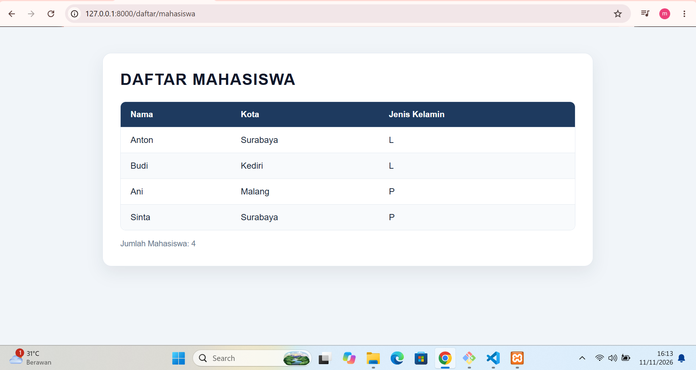
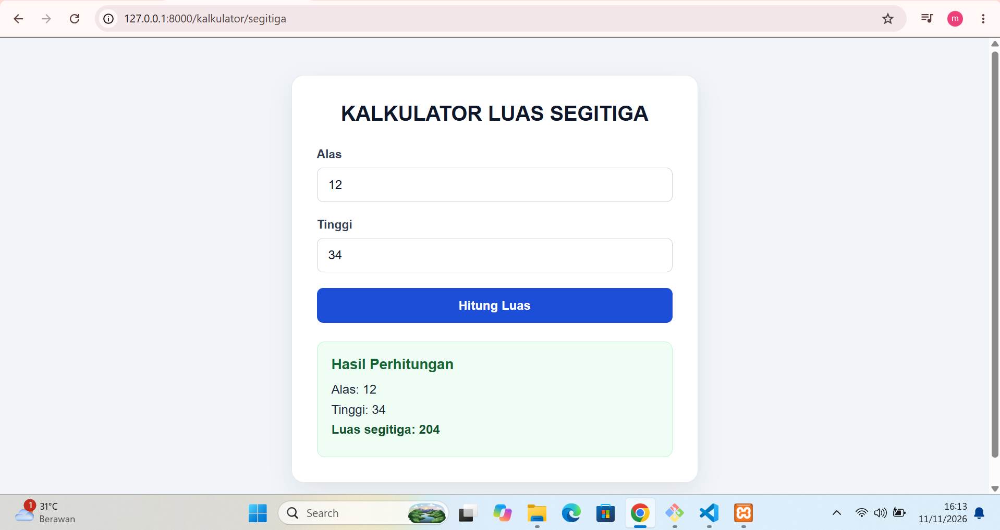

# Praktikum Laravel: Daftar Mahasiswa dan Kalkulator Segitiga

## Deskripsi

Project praktikum ini merupakan aplikasi web sederhana menggunakan Laravel. Aplikasi menyediakan halaman daftar mahasiswa dan kalkulator luas segitiga. Routing mengarahkan permintaan ke controller, lalu controller menampilkan halaman Blade. Kedua halaman menggunakan Bootstrap 5 melalui CDN untuk tampilan responsif.

## Tujuan

- Memahami routing pada Laravel.
- Menggunakan controller untuk menyiapkan data dan memproses input.
- Menampilkan data dengan Blade Template.
- Menggunakan Bootstrap 5 untuk membuat halaman lebih rapi dan responsif.
- Memvalidasi input pada form kalkulator.

## Teknologi

Versi berikut diambil dari konfigurasi project dan `composer.lock`:

| Teknologi | Versi / keterangan |
|---|---|
| Laravel Framework | 13.40.0 (versi terkunci di `composer.lock`) |
| PHP | `^8.3` (persyaratan di `composer.json`; versi PHP yang terpasang tidak diperiksa) |
| Bootstrap | 5.3.3 (stylesheet dimuat dari jsDelivr CDN di kedua view) |
| Blade | Template engine bawaan Laravel, digunakan untuk view dan sintaks Blade |

Bootstrap dimuat dari CDN, sehingga kedua halaman tidak memerlukan instalasi NPM atau proses build Vite untuk menampilkan styling-nya. Browser perlu memiliki akses internet agar stylesheet Bootstrap dari CDN dapat dimuat.

## Fitur

### Daftar mahasiswa

Halaman daftar mahasiswa menampilkan data yang disiapkan oleh `MahasiswaController`:

| Nama | Kota | Jenis Kelamin |
|---|---|---|
| Anton | Surabaya | L |
| Budi | Kediri | L |
| Ani | Malang | P |
| Sinta | Surabaya | P |

View menggunakan perulangan Blade `@foreach` untuk menampilkan data dan menghitung jumlah mahasiswa. Tabel menggunakan komponen dan kelas Bootstrap seperti `table`, `table-striped`, `table-hover`, dan `table-responsive`.

### Kalkulator luas segitiga

Halaman kalkulator menyediakan input alas dan tinggi. `KalkulatorController` memvalidasi agar keduanya wajib diisi, berupa angka, dan lebih besar dari nol. Jika valid, halaman menampilkan kembali nilai input dan hasil perhitungan. Form menampilkan token CSRF, mempertahankan input sebelumnya saat validasi gagal, dan menggunakan Bootstrap Alert untuk pesan kesalahan maupun hasil perhitungan.

Rumus yang digunakan:

```text
luas = 0.5 × alas × tinggi
```

## Struktur folder terkait

```text
web-app/
├── app/
│   └── Http/
│       └── Controllers/
│           ├── Controller.php
│           ├── Web.php
│           ├── MahasiswaController.php
│           └── KalkulatorController.php
├── bootstrap/
├── config/
├── database/
├── docs/
│   └── screenshots/
│       ├── README.md
│       ├── daftar-mahasiswa.png
│       └── kalkulator-segitiga.png
├── public/
│   ├── favicon.ico
│   ├── index.php
│   └── robots.txt
├── resources/
│   ├── css/
│   │   └── app.css
│   ├── js/
│   │   └── app.js
│   └── views/
│       ├── welcome.blade.php
│       ├── kalkulator/
│       │   └── segitiga.blade.php
│       ├── mahasiswa/
│       │   └── index.blade.php
├── routes/
│   ├── web.php
│   └── console.php
├── storage/
├── tests/
├── artisan
├── composer.json
└── composer.lock
```

Folder `resources/css/` dan `resources/js/` tetap ada sebagai bagian project Laravel, tetapi kedua view praktikum saat ini memuat Bootstrap 5 langsung dari CDN.

## Routing

Route aplikasi didefinisikan di `routes/web.php`:

| Method | URL | Nama route | Handler |
|---|---|---|---|
| GET | `/daftar/mahasiswa` | `daftar.mahasiswa` | `MahasiswaController@index` |
| GET | `/kalkulator/segitiga` | `kalkulator.segitiga` | `KalkulatorController@index` |
| POST | `/kalkulator/segitiga` | `kalkulator.segitiga.hitung` | `KalkulatorController@hitung` |

Route GET kalkulator menampilkan form. Form mengirim input melalui POST ke route perhitungan. Route mahasiswa meminta controller mengirim data mahasiswa ke view.

## Cara menjalankan project

Jalankan perintah berikut dari folder utama Laravel (`web-app`). Pastikan PHP versi yang memenuhi persyaratan `^8.3` dan Composer tersedia. Untuk memasang dependensi PHP project:

```bash
composer install
```

Pastikan file `.env` tersedia dan memiliki `APP_KEY`. Jika belum ada, salin `.env.example` menjadi `.env`, lalu buat key aplikasi:

```powershell
Copy-Item .env.example .env
php artisan key:generate
```

Jika file `.env` sudah tersedia, lewati perintah `Copy-Item` agar konfigurasi lokal tidak tertimpa.

Jalankan server pengembangan Laravel:

```bash
php artisan serve
```

Buka URL yang ditampilkan Artisan di browser (umumnya `http://127.0.0.1:8000`). Untuk halaman praktikum ini tidak perlu menjalankan Vite atau NPM karena stylesheet Bootstrap diambil dari CDN. Koneksi internet diperlukan ketika browser memuat stylesheet tersebut.

## URL halaman

- Daftar mahasiswa: `http://127.0.0.1:8000/daftar/mahasiswa`
- Kalkulator luas segitiga: `http://127.0.0.1:8000/kalkulator/segitiga`

## Screenshot tampilan aplikasi

Screenshot yang sudah tersedia di folder `screenshots/` ditampilkan di bawah. Gambar-gambar ini mendokumentasikan tampilan sebelum pembaruan Bootstrap 5, jadi tampilannya mungkin berbeda dari halaman saat ini. Untuk mendokumentasikan tampilan Bootstrap terbaru, ambil screenshot baru dan ganti berkas yang sesuai.

### Daftar mahasiswa



[Buka file daftar-mahasiswa.png](screenshots/daftar-mahasiswa.png)

### Kalkulator luas segitiga



[Buka file kalkulator-segitiga.png](screenshots/kalkulator-segitiga.png)

## Kesimpulan

Project ini memperlihatkan alur dasar Laravel: route menerima permintaan, controller menyiapkan atau memproses data, dan view Blade menampilkan halaman. Fitur daftar mahasiswa menggunakan data sederhana, sedangkan kalkulator menerapkan validasi input dan rumus luas segitiga.

## Referensi Laravel

- [Dokumentasi Laravel](https://laravel.com/docs)
- [Dokumentasi routing](https://laravel.com/docs/routing)
- [Dokumentasi Blade](https://laravel.com/docs/blade)
- [Laracasts](https://laracasts.com)

Lisensi project pada `composer.json` tercatat sebagai MIT.
